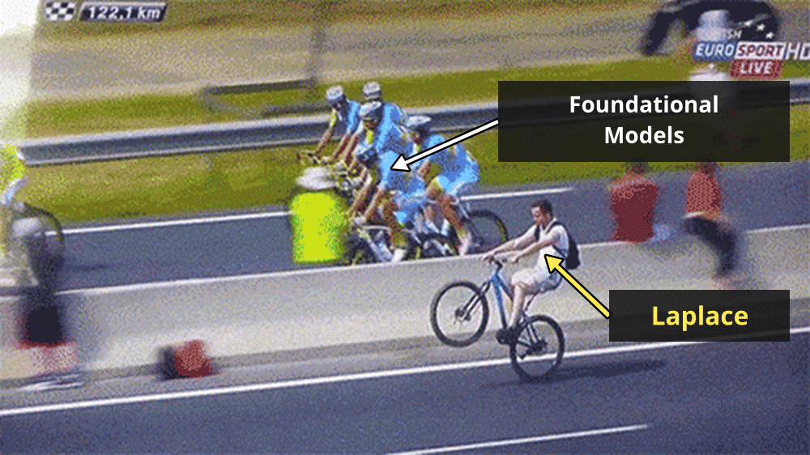

# skaters ([docs](https://skaters.microprediction.org/), [demo](https://skaters.microprediction.org/demos/playground.html))

Online, distributional, univariate time-series forecasting in Python, JavaScript, R, Julia and Rust.

<p align="center">
  <a href="https://skaters.microprediction.org/"></a>
  <a href="#javascript-r-julia-rust--the-browser"></a>
</p>

`laplace` is a useful benchmark for short-horizon prediction. It performs solidly across economic, price and seasonal series, and it is fully autonomous: no training, no tuning, one call per observation. Being autonomous, it cannot beat a tuned model, a tuned version of itself (`granger`), or a custom construction built for a series you know something about, such as a non-negative one. Use skaters as a toolkit for those constructions, or import the autonomous forecasters as they are.

It was written to monitor hundreds of thousands of economic series. Several foundational time-series models are ahead of it on monthly, weekly and hourly series; it is ahead on daily economic series and costs microseconds per update. The paired results, per series and per stratum, are on [foundationalprediction.com](https://foundationalprediction.com/).

<p align="center">
  
</p>

## Install

```bash
pip install skaters
```

## Use

```python
from skaters import laplace

f = laplace()                 # or laplace(k=3) for three horizons
state = None
for y in observations:
    dists, state = f(y, state)
    d = dists[0]              # predictive distribution for the next value
    d.mean, d.std, d.quantile(0.95), d.logpdf(y_next)
```

Each call takes one observation and returns a distribution for the next value, in O(1) time. `state["pit"]` and `state["z"]` give a calibrated surprise for every arriving point. Score a forecast only against values that arrive after it was issued.

## The forecasters

| | what it is |
|---|---|
| `laplace(k)` | the general forecaster: a likelihood-weighted ensemble of transform chains with a distributional leaf; multi-step to `k=12` |
| `granger(frequency=...)` | `laplace` with hyperparameters trained per frequency (monthly, weekly, hourly), mixed with `laplace` so its total log score is never more than log 4 behind |
| `flesaker(lower=0)` | experimental: `laplace` on `log(y - lower)`, mapped back exactly, for series with a known bound |

Not recommended for price and return series, where a fitted GARCH-t is the better tool, and not a substitute for a model that uses covariates or exogenous regressors (see [ice-skaters](https://ice-skaters.microprediction.org) and the [exogenous-variables skill](https://skaters.microprediction.org/skills.html#exogenous-variables)).

## The toolkit

Every forecaster is built from transforms, leaves and ensembles that you can recombine. A transform changes the coordinates, a skater forecasts in them, and `conjugate` maps the forecast back:

```python
from skaters import conjugate, leaf, ou_transform, laplace, log_transform

spread = conjugate(leaf(k=10), ou_transform(kappa=0.1), k=10)     # mean reversion
positive = conjugate(laplace(), log_transform(lower=0.0))          # a positive series
```

The transforms (differencing, EMA level, drift, Holt, AR, fractional differencing, seasonal difference and anchor, standardisation, GARCH, Yeo-Johnson, power, log, OU) and ensembles are documented in the [methodology guide](https://skaters.microprediction.org/guide.html), with runnable recipes on the [examples page](https://skaters.microprediction.org/examples.html).

## Documentation

- [Examples](https://skaters.microprediction.org/examples.html): runnable recipes
- [FAQ](https://skaters.microprediction.org/faq.html): why it exists, what it does and does not do
- [Methodology](https://skaters.microprediction.org/guide.html): how `laplace` and `granger` are built
- [Scope](https://skaters.microprediction.org/scope.html): prior knowledge, horizons, units
- [Metrics](https://skaters.microprediction.org/metrics.html): why log likelihood is the default score
- [Claude skills](https://skaters.microprediction.org/skills.html): copyable instructions for common tasks
- [Languages](https://skaters.microprediction.org/languages.html): the JavaScript, R, Julia and Rust ports, parity-checked to 1e-6
- [REFERENCE.md](REFERENCE.md): the detailed reference (architecture, `Dist`, transforms, ensembles, `dantzig`, spec system, `skaters.torch`, theory)

## Papers

- Transforms all the way down, the methods paper: [PDF](papers/skaters-jss.pdf), [SSRN](https://papers.ssrn.com/abstract=7220478)
- A stronger univariate benchmark for foundational time-series model evaluation: [PDF](papers/stronger-benchmark/stronger-benchmark.pdf), [SSRN](https://papers.ssrn.com/abstract=7583618), [reproduce](papers/stronger-benchmark/REPRODUCE.md)
- On the importance of evaluating foundational time-series models one step ahead in an investment context: [PDF](https://foundationalprediction.com/horizon-note.pdf)

## Cite

Please cite *Transforms all the way down* ([SSRN 7220478](https://papers.ssrn.com/abstract=7220478)).

```bibtex
@misc{cotton2026skaters,
  title  = {Transforms All the Way Down --- Automatic Online Distributional
            Forecasting by Conjugation},
  author = {Cotton, Peter},
  year   = {2026},
  note   = {SSRN 7220478, https://skaters.microprediction.org}
}
```

## Lineage

skaters distils ideas from [timemachines](https://github.com/microprediction/timemachines), which gave dozens of time-series packages a common interface. It is a from-scratch rewrite for speed, distributional prediction and the browser.
